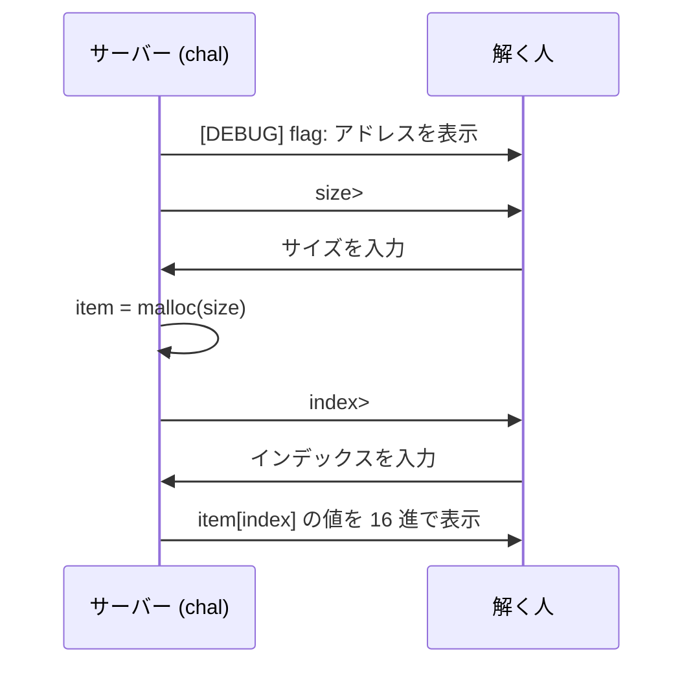
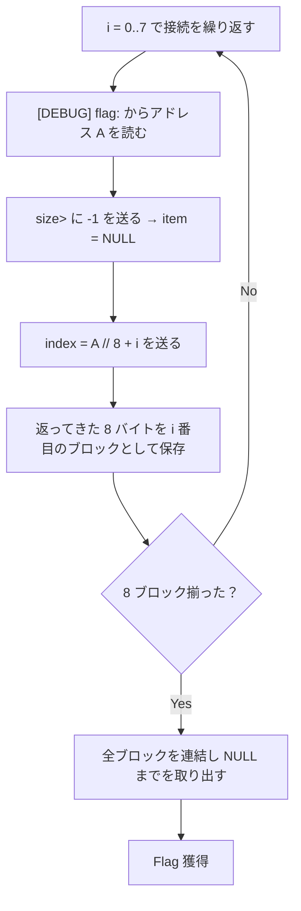

> [!IMPORTANT]
> **Solved with Gemini in Colab**
>
> この問題は Google の AI コーディングアシスタント **Gemini in Colab** を活用して解決されました。

> [!NOTE]
> この Writeup は AI により自動生成されています。 本ドキュメントは、AI アシスタントを用いて作成された Writeup です。記載内容は解法の一例であり、内容の正確性については十分にご確認の上ご利用ください。

# what is my pointer 4

## 概要
*   **カテゴリー**: Pwn
*   **トピック**: malloc
*   **難易度**: Hard
*   **問題リンク**: [what is my pointer 4 - Daily AlpacaHack](https://alpacahack.com/daily/challenges/what-is-my-pointer-4)

## 使用ツール
*   **Python 3**: 解法スクリプトの実装
*   **socket / struct / re**: サーバーとの通信、リトルエンディアンの復元、出力の抽出（いずれも Python 標準ライブラリ）

## 問題の分析
本問題は、**Daily AlpacaHack** の Pwn 問題です。配布ファイルは次の通りです。

| ファイル | 内容 |
| :--- | :--- |
| `chal.c` | 本体のソースコード |
| `chal` | `chal.c` をコンパイルした実行ファイル |
| `Dockerfile` | `chal` を `xinetd` で TCP 公開するコンテナ定義 |
| `compose.yml` | コンテナを起動する設定 |

`chal.c` の中身は次の通りです。

```c
int main(void) {
    printf("[DEBUG] flag: %p\n", getenv("FLAG"));

    puts("part1: alloc");
    size_t size;
    printf("size> ");
    scanf("%ld%*c", &size);
    unsigned long *item = malloc(size);

    puts("part2: read");
    printf("index> ");
    off_t index;
    scanf("%ld%*c", &index);
    printf("0x%lx\n", item[index]);

    puts("bye!!");
}
```

やり取りは「サイズを 1 つ入力して `malloc` し、インデックスを 1 つ入力してその要素を読む」だけです。問題のタイトル通り、鍵は `item` という **ポインタがどこを指すか** です。



## 脆弱性の詳細

### 1. フラグのアドレスが丸見え
プログラムは起動直後に `getenv("FLAG")` の戻り値、つまり **環境変数 `FLAG` が置かれているアドレス** を `%p` で表示します。読みたいデータがメモリ上のどこにあるかが、毎回そのまま教えられます。

### 2. `malloc` を失敗させて `item` を NULL にする
`size` は `size_t`（符号なし 64bit）ですが、`scanf("%ld")` で読むため `-1` を入力すると `0xffffffffffffffff`（`SIZE_MAX`）として解釈されます。この巨大なサイズでは確保に失敗し、`malloc` は `NULL`（= 0）を返します。

```math
\texttt{size} = \texttt{-1} \;\Rightarrow\; \texttt{SIZE\_MAX} \;\Rightarrow\; \texttt{item} = \texttt{malloc(size)} = 0
```

### 3. 任意アドレス読み取りへ
`item` が 0 になると、`item[index]` は次の式のアドレスを参照します。`item` は `unsigned long *`（1 要素 8 バイト）なので、インデックスは 8 倍されます。

```math
\texttt{item[index]} = *(\texttt{item} + \texttt{index}) = *(\texttt{index} \times 8)
```

`index` は `off_t`（符号付き 64bit）なので、事実上どんなアドレスでも指定できます。読みたいアドレスを $`A`$ とすると、必要なインデックスは次の通りです。

```math
\texttt{index} = \left\lfloor \frac{A}{8} \right\rfloor
```

フラグのアドレスは手順 1 で分かっているので、そこから 8 バイトずつ読み出せばフラグ全体を復元できます。

> [!NOTE]
> サーバーは 1 接続につき「1 回の読み取り」しかさせてくれません。そのため、接続をやり直しながら 8 バイトずつずらして読み、フラグをつなぎ合わせます。

### 4. アドレスは接続のたびに変わる（ASLR）
環境変数はスタック上に置かれ、アドレス空間配置のランダム化（**ASLR**）によって接続ごとに位置が変わります。したがって、過去の接続で得たアドレスを使い回すことはできません。各接続で表示される `[DEBUG] flag:` の値を **その接続内で** 読み、そのアドレスを基準にインデックスを計算する必要があります。

## 攻撃フロー


## 用語解説
*   **`malloc` の失敗**: 要求サイズが大きすぎるなどで確保できないとき、`malloc` は `NULL`（0）を返します。本問ではこれを意図的に起こして `item` を 0 にします。
*   **ASLR（Address Space Layout Randomization）**: スタックやライブラリの配置アドレスを起動ごとにランダム化する保護機構です。本問ではアドレスが毎回表示されるため、保護になっていません。
*   **`off_t` / `size_t`**: それぞれ符号付き・符号なしの整数型です。符号の違いが `-1` の解釈（巨大サイズ化）と負インデックスの可否に効いてきます。
*   **リトルエンディアン**: 8 バイトの値を下位バイトから並べる方式です。`struct.pack("<Q", val)` でバイト列に戻してから文字として連結します。

## 補足
読み取り粒度が 8 バイト固定でも、フラグのアドレスが分かっているため計算はずれません。$`i`$ 番目の接続で読むアドレスは $`A_i = A_i' - (A_i' \bmod 8) + 8i`$ のようにそのつど基準化され、保存先オフセットも同じ基準で求めます。ここで $`A_i'`$ は $`i`$ 番目の接続で表示されたフラグアドレスです。各接続で基準を取り直すことで、ASLR で絶対位置が変わっても相対位置（フラグ先頭からの距離）は常に正しく対応します。

> [!WARNING]
> 「確保サイズ」や「インデックス」をユーザー入力のまま使い、確保の成否もチェックしないと、`NULL` 参照からの任意アドレス読み取りにつながります。`malloc` の戻り値は必ず検査し、インデックスには範囲チェックを入れるべきです。

## 解決スクリプト
[solve.py を参照してください](./solve.py)

```bash
python3 solve.py <HOST> <PORT>
```

接続先の HOST と PORT は、問題ページでインスタンスを起動して確認してください。
